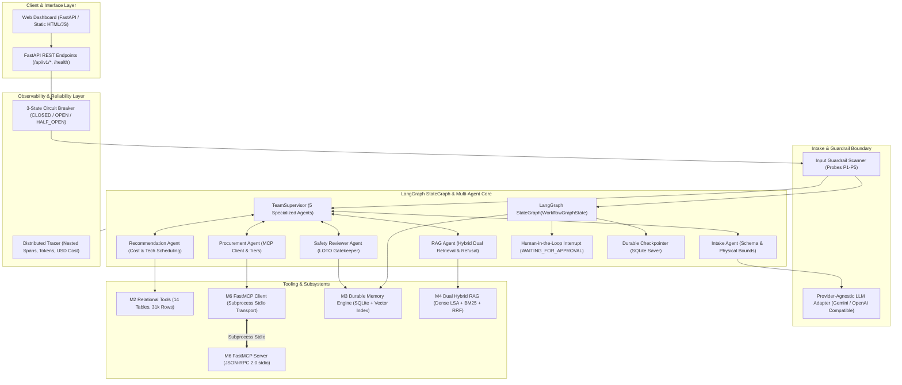

# PlantGuard: System Architecture & Design Specification

## 1. High-Level System Architecture

---

## 2. Component Design & Responsibilities

### 2.1 Provider-Agnostic LLM Adapter (`app/adapters/llm_adapter.py`)
- Standardized `LLMResponse` containing content, token counts (`prompt_tokens`, `completion_tokens`, `total_tokens`), estimated cost in USD, and latency in milliseconds.
- Provider abstraction supporting Gemini (`gemini-2.0-flash`), OpenAI-compatible providers (`gpt-4o-mini`), and local Ollama.
- Zero provider SDK calls outside adapter; provider switching achieved via `PLANTGUARD_LLM_PROVIDER` environment variable without code changes.
- Bounded schema repair loop (`MAX_REPAIR_ATTEMPTS = 3`) validating structured Pydantic models with error feedback and fail-safe structured exit.

### 2.2 LangGraph StateGraph & Subprocess Approval Checkpointing (`app/graph/`)
- Typed graph state `WorkflowGraphState(TypedDict)` with typed channels for alerts, telemetry, safety reviews, approvals, and execution records.
- True LangGraph `StateGraph` compilation with pure conditional routing and recursion limits:
  $$\text{alert\_intake} \to \text{validation} \to \text{sensor\_history} \to \text{root\_cause} \to \text{rag\_lookup} \to \text{maintenance\_recommendation} \to \text{safety\_review} \to \text{human\_approval} \to \text{execution}$$
- Subprocess durability: Halts automatically at `human_approval` whenever LOTO or PO > 200,000 INR is triggered.
- Process isolation: Process 1 executes in an isolated child OS process, checkpoints to SQLite, and exits. Process 2 boots from disk, loads state, and resumes approved execution.
- Side-effect execution automatically registers completed work orders into `PersistentMemoryManager`.

### 2.3 Durable Multi-Tier Persistent Memory Engine (`app/memory/`)
- Multi-tier SQLite persistence (`plantguard_memory.db`) storing:
  - Stable asset facts and technical specifications (superseded with versioning).
  - Past maintenance history and work order records.
  - Procedural Lockout/Tagout (LOTO) steps.
  - Per-session working memory with rolling trim budget (`max_history`).
- Real OS child process restart verification (standard test suite T1 through T9).
- Semantic TF-IDF/LSA vector index for fast offline retrieval of maintenance SOPs.
- Right-to-be-forgotten GDPR identity purging (`purge_identity_data`).

### 2.4 Hybrid RAG & Retrieval Engine (`app/rag/`)
- Multi-format loader ingesting both Markdown (`.md`) and Portable Document Format (`.pdf`) manuals.
- Dual retrieval pipeline combining BM25 keyword matching with dense LSA/TF-IDF semantic vector space.
- Reciprocal Rank Fusion (RRF, $k=60$) combining keyword precision and semantic recall.
- Cross-scoring reranker boosting asset-specific equipment codes.
- Strict citation enforcement (`[slug-secXX]`) with zero synthetic fallback hallucinations; unanswerable queries explicitly refused.

### 2.5 FastMCP Subprocess Architecture (`app/mcp/`)
- Standard Model Context Protocol (MCP) server running via `sys.stdin`/`sys.stdout` JSON-RPC 2.0 transport.
- Clean isolation: Server logging strictly diverted to `sys.stderr` to prevent JSON-RPC stream corruption.
- Registered capabilities:
  - Tools: `check_spare_parts_inventory`, `calculate_downtime_cost`, `get_supplier_info`.
  - Resource: `plantguard://policies/procurement_approval_matrix`.
  - Prompt: `loto_briefing`.
- `PlantGuardMCPClient` manages subprocess spawning, JSON-RPC serialization, and request/response dispatch across OS process boundaries.

### 2.6 Multi-Agent Team Supervisor (`app/agents/`)
- 5 specialized autonomous agents with scoped role prompts and partitioned state:
  1. `IntakeAgent`: Telemetry parsing, schema validation, physical plausibility limits.
  2. `RAGAgent`: Grounded corpus retrieval with exact citations and refusal discipline.
  3. `RecommendationAgent`: Tool-enabled downtime calculation and technician scheduling.
  4. `ProcurementAgent`: Inventory check and financial tier routing via MCP tools and policy resources.
  5. `SafetyAgent`: Non-negotiable LOTO gatekeeper and permit verification.
- `TeamSupervisor` orchestrator enforcing bounded hops, convergence checks, and conflict resolution.
- Live HTTP interface exposed via FastAPI at `/api/v1/team/run`.

### 2.7 Observability & Circuit Breaker Reliability (`app/observability/`)
- Distributed `Tracer` recording one trace per HTTP request with nested execution spans.
- Captures span latency, status, error messages, token usage (prompt, completion, total), and USD cost.
- Dynamic KPI calculator (`compute_dynamic_kpis`) computing uptime %, breaker trip counts, and throughput strictly from live trace files.
- 3-State Circuit Breaker (`CLOSED`, `OPEN`, `HALF_OPEN`) wrapping all production FastAPI routes to guarantee fast failure and 100% graceful degradation under fault injection.

### 2.8 Safety Guardrails & Adversarial Resilience (`app/safety/`)
- Adversarial Probes P1 through P5:
  - Probe P1: Direct prompt injection blocking.
  - Probe P2: Indirect prompt injection scanning and containment.
  - Probe P3: Physical infeasibility detection and prohibition of alarm suppression.
  - Probe P4: Unsupported topic detection and fabrication refusal.
  - Probe P5: Structural and schema error handling returning HTTP 422.
- Evaluated against 20 end-to-end golden cases with `LLMJudge`, achieving a 100% pass rate.
