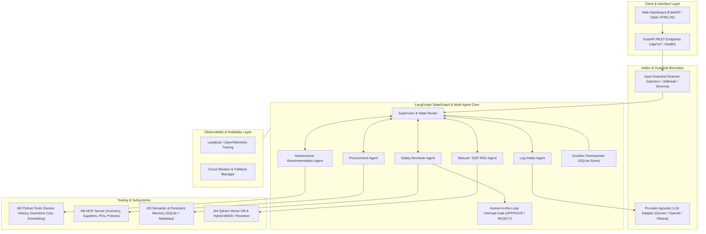

# PlantGuard: System Architecture & Design Specification

## 1. High-Level System Architecture

---

## 2. Component Design & Responsibilities

### 2.1 Provider-Agnostic LLM Adapter (`app/adapters/llm_adapter.py`)
- Standardized `LLMResponse` containing raw text, token counts (prompt, completion, total), estimated cost, latency in ms, and fallback indicators.
- Base class `BaseLLMProvider` with concrete implementations:
  - `GeminiProvider`: Direct native Google Generative AI SDK with structured outputs.
  - `OpenAICompatibleProvider`: Compatible with OpenAI, OpenRouter, and local Ollama.
- `LLMAdapter` orchestrator:
  - Automatically loads credentials from `app.config.settings.Settings`.
  - Implements bounded repair loop (`MAX_REPAIR_ATTEMPTS = 3`).
  - Seamlessly handles fallback to secondary provider if primary fails with retryable error.

### 2.2 LangGraph State Schema & Routing (`app/graph/state.py`, `app/graph/workflow.py`)
- Pydantic-based `PlantGuardState`:
  - `event_id: str`
  - `raw_text: str`
  - `maintenance_event: Optional[MaintenanceEvent]`
  - `sensor_analysis: Optional[SensorAnalysisResult]`
  - `retrieved_evidence: List[RetrievedChunk]`
  - `recommendation: Optional[MaintenanceRecommendation]`
  - `procurement_plan: Optional[ProcurementPlan]`
  - `safety_review: Optional[SafetyReviewResult]`
  - `approval_status: ApprovalStatus (PENDING, APPROVED, REJECTED, AUTO_APPROVED)`
  - `execution_side_effects: List[ExecutionRecord]`
  - `current_step: str`
  - `iteration_count: int`
  - `errors: List[str]`
- Conditional Edges:
  - Strict inspection of `safety_critical` flag and `requires_human_approval`.
  - If high risk or safety critical, edge routes directly to `human_approval_interrupt` node.
  - Rejection routes directly to `safe_terminal_node` without executing any side-effects.

### 2.3 Persistent Memory Engine (`app/memory/persistent_memory.py`)
- Independent from transient conversational transcript context.
- Dual storage:
  - Asset-specific historical events (past work orders, failure modes, completed fixes).
  - Stable asset facts & parameters (criticality, modifications, serials).
- SQLite-backed durable store surviving application restart.
- Explicit write/update policy: newer facts supersede older facts with audit trail.
- Multi-tenant / asset isolation to prevent cross-asset leakage.

### 2.4 Hybrid RAG Subsystem (`app/rag/engine.py`)
- Qdrant Vector Database (in-memory mode for development/tests, networked mode for production).
- Ingestion pipeline parsing Markdown and PDF manuals with structural chunking (retaining header hierarchy, table citations, and asset class tags).
- Hybrid retrieval: Dense vector similarity + BM25 keyword matching with Reciprocal Rank Fusion (RRF).
- Cross-Encoder Reranking: Re-scores top K candidate chunks; enforces top reranked order in prompt context.
- Strict citation enforcement: Model prompt constraints require citing chunk ID and manual clause. Absent evidence triggers explicit statement of verification gap.

### 2.5 Model Context Protocol (MCP) Server & Client (`app/mcp/`)
- FastMCP stdio/SSE server exposing:
  - Tools: `query_inventory`, `check_part_lead_time`, `calculate_reorder_cost`, `prepare_purchase_order`.
  - Resources: `plantguard://policies/procurement_approval_matrix`, `plantguard://standards/loto_summary`.
  - Prompts: `procurement_rfq_template`.
- Stdio MCP server logs strictly to `stderr` to preserve JSON-RPC protocol integrity on `stdout`.
- Python client wrapping standard MCP client session for consumption by the Procurement Agent.

### 2.6 Safety & Policy Engine (`app/safety/policy_engine.py`)
- Deterministic code-level safety validation rules:
  - Physical plausibility checks on all sensor variables.
  - Criticality calculation adhering strictly to standard clause 2.1.
  - Mandatory permit matching against task requirements.
  - Mandatory LOTO checklist verification for hazardous energy sources.
  - Technician trade qualification and certification checks.
  - Financial authorization tiers: PO <= ₹200,000 auto-reorder eligible; ₹200k–₹1M Maintenance Manager; > ₹1M Plant Head.

### 2.7 Observability & Reliability (`app/observability/`)
- Tracing integration with Langfuse / structured span logger.
- Circuit Breaker pattern with states: `CLOSED`, `OPEN`, `HALF_OPEN`.
- Exponential backoff with jitter on transient network/API failures.
- Non-retryable classification for Pydantic validation errors.
